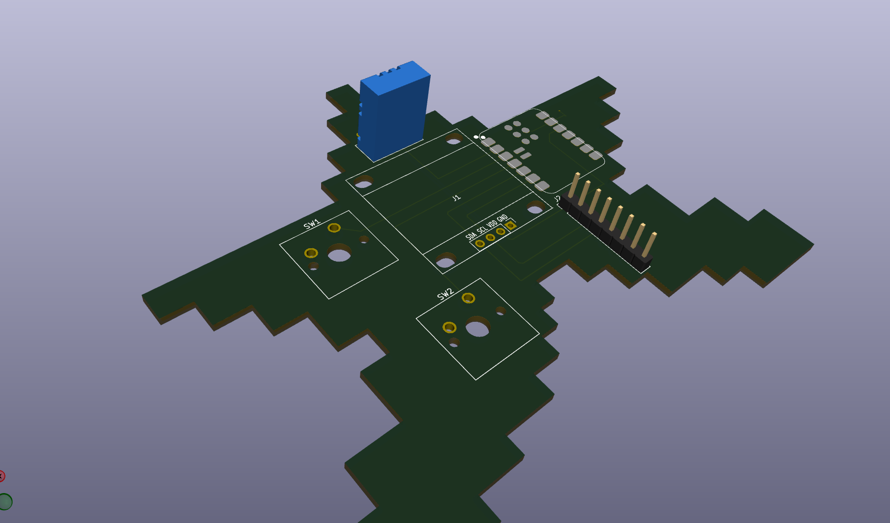
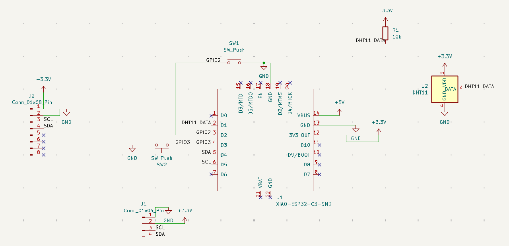
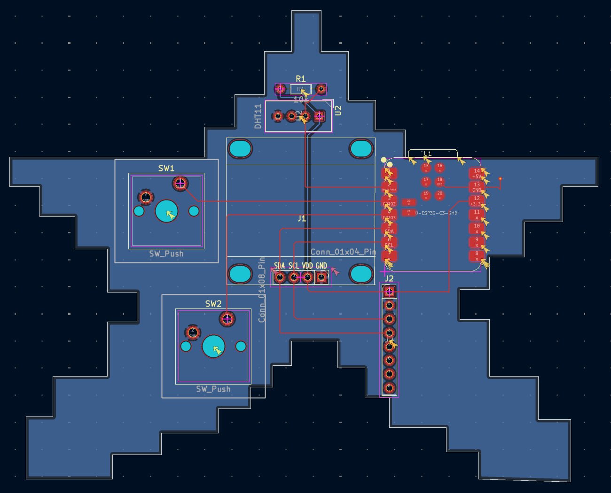

# Starbie

Starbie is a small desk pet on a star-shaped PCB. A little creature wanders around an OLED screen, and you interact with it by pressing two buttons and by tilting and shaking the board. It runs on a Seeed XIAO ESP32-C3.



## What's on the board

- **Seeed XIAO ESP32-C3**: the microcontroller. It also powers everything over USB-C.
- **0.96" OLED screen (128x64, I2C)**: shows the pet.
- **MPU6050 motion sensor**: lets the pet react to tilting and shaking.
- **DHT11 sensor**: reads room temperature and humidity for the stats screen. Optional.
- **Two Cherry MX-style switches**: the buttons.
- **10k resistor**: pull-up for the DHT11's data line.

## Schematic



| Part | XIAO pin | GPIO |
|---|---|---|
| DHT11 data | D1 | GPIO3 |
| Button 1 | D2 | GPIO4 |
| Button 2 | D3 | GPIO5 |
| OLED + MPU6050 SDA | D4 | GPIO6 |
| OLED + MPU6050 SCL | D5 | GPIO7 |

The screen and motion sensor share the same two I2C wires (SDA and SCL). Each button connects a pin to ground when pressed. Everything runs from the XIAO's 3.3V output.

## PCB



How I designed it:

1. **Schematic.** I drew the circuit in KiCad using labels instead of long wires: any two pins with the same label are connected.
2. **Footprints.** I assigned each part its physical shape. The screen and XIAO footprints came from the guide's care package.
3. **Layout.** I placed the parts and drew the star outline, with the XIAO's USB-C end right at the edge of the board so a cable can plug in. My first layout had the DHT11 sitting in front of the USB port, so I moved it to the top point of the star.
4. **Routing.** The signal traces are on the front layer. The power line to the DHT11 and resistor runs on the back so it doesn't cross the front traces. I moved the 3.3V trace under the XIAO after the first version passed only 0.26 mm from the XIAO's side pads.
5. **Ground fill.** Instead of routing ground by hand, I filled the back layer with ground copper. The XIAO's ground pads are front-only, so a short trace and a via connect them down to the back fill.
6. **Design rules check.** DRC passes with 0 unconnected items. The only 2 errors are "malformed courtyard" on the screen footprint, which the guide says to ignore.

The board is 2 layers. `gerbers.zip` has everything needed to order it.

## Bill of materials

Prices are estimates per unit; many parts are sold in packs. Also in [BOM.csv](BOM.csv).

| Part | Qty | Est. price each | Link | Notes |
|---|---|---|---|---|
| Seeed XIAO ESP32-C3 | 1 | $4.99 | [Seeed Studio](https://www.seeedstudio.com/Seeed-XIAO-ESP32C3-p-5431.html) | U1 |
| 0.96" 128x64 I2C OLED (SSD1306) | 1 | $2.50 | [Amazon](https://www.amazon.com/dp/B0GBVWBWCR) | J1. Pin order must be GND, VCC, SCL, SDA |
| MPU6050 (GY-521) module | 1 | $2.29 | [Amazon](https://www.amazon.com/dp/B0943SGP34) | J2 |
| DHT11 sensor, bare 4-pin | 1 | $3.33 | [Amazon](https://www.amazon.com/dp/B0BLG7R99R) | U2. Optional |
| 10k resistor | 1 | $0.05 | [Amazon](https://www.amazon.com/dp/B0B4JFPHTW) | R1. Only needed with the DHT11 |
| Cherry MX-style switch | 2 | $0.18 | [Amazon](https://www.amazon.com/dp/B0FQP8VYX4) | SW1, SW2 |
| MX keycap | 2 | $0.60 | [Amazon](https://www.amazon.com/dp/B0CQ2VLMVY) | Optional |
| PCB, 2 layers | 1 | $10.00 | [JLCPCB](https://jlcpcb.com/) | Upload `gerbers.zip`; includes estimated shipping |
| **Total** | | **about $25** | | |

## Ordering the PCB

1. Go to [JLCPCB](https://jlcpcb.com/) and click **Add gerber file**.
2. Upload `gerbers.zip`. The defaults (2 layers, 1.6 mm, any color) work.
3. Check the preview shows the star shape, then order.

## Flashing the firmware

The code is a single Arduino sketch in [Firmware/Starbie/Starbie.ino](Firmware/Starbie/Starbie.ino).

1. Install the [Arduino IDE](https://www.arduino.cc/en/software).
2. Open **File → Preferences** and add this to **Additional Boards Manager URLs**:
   ```
   https://espressif.github.io/arduino-esp32/package_esp32_index.json
   ```
3. Open **Tools → Board → Boards Manager**, search for `esp32`, and install **esp32 by Espressif Systems**.
4. Open **Sketch → Include Library → Manage Libraries** and install:
   - Adafruit GFX Library
   - Adafruit SSD1306
   - Adafruit MPU6050
   - DHT sensor library

   Choose **Install All** if it asks about dependencies.
5. Plug in the XIAO. Choose **Tools → Board → esp32 → XIAO_ESP32C3**, then pick its port under **Tools → Port**.
6. Open `Starbie.ino` and click **Upload**.

If you didn't solder the DHT11, change this line near the top of the sketch before uploading:

```
const bool USE_DHT11 = false;
```

I changed the I2C pins in the sketch (SDA = GPIO6, SCL = GPIO7) to match this board's wiring. The original sketch had them swapped.

## Controls

| Control | What it does |
|---|---|
| Button 1 | Opens the menu; press again to choose |
| Tilt while the menu is open | Moves the selector |
| Button 2 | Shows or hides the stats screen |
| Shake | Starbie reacts |


